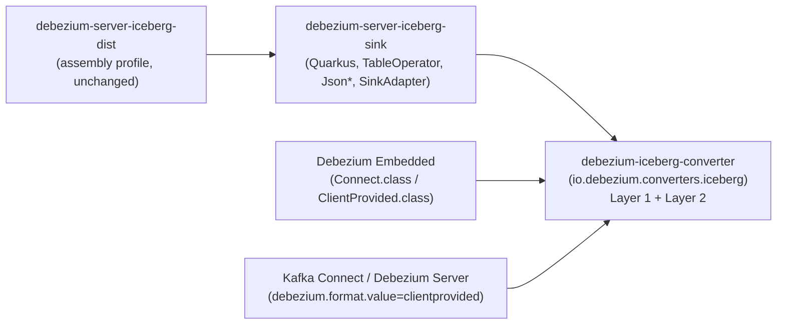
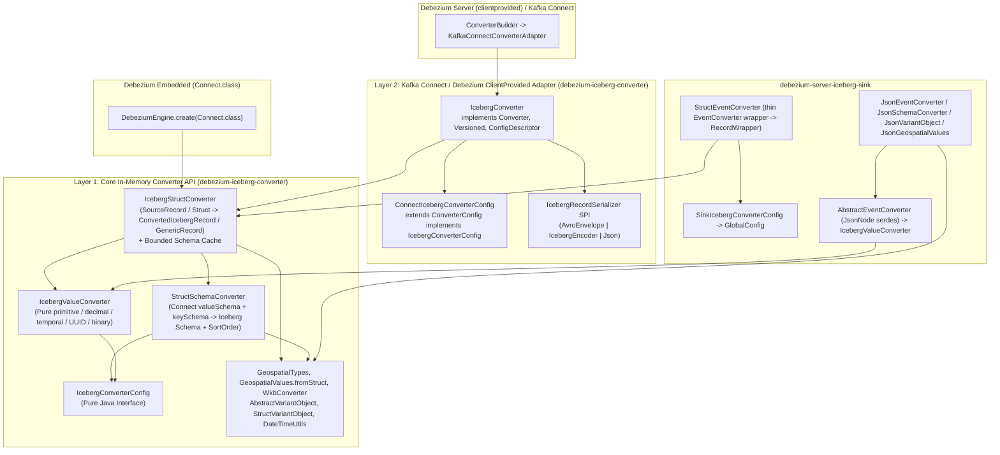
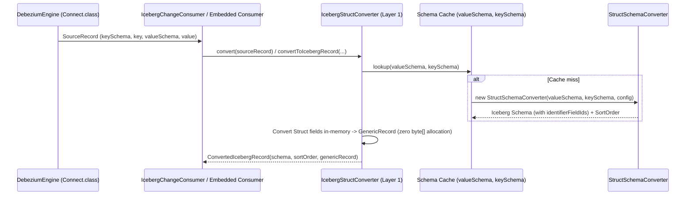
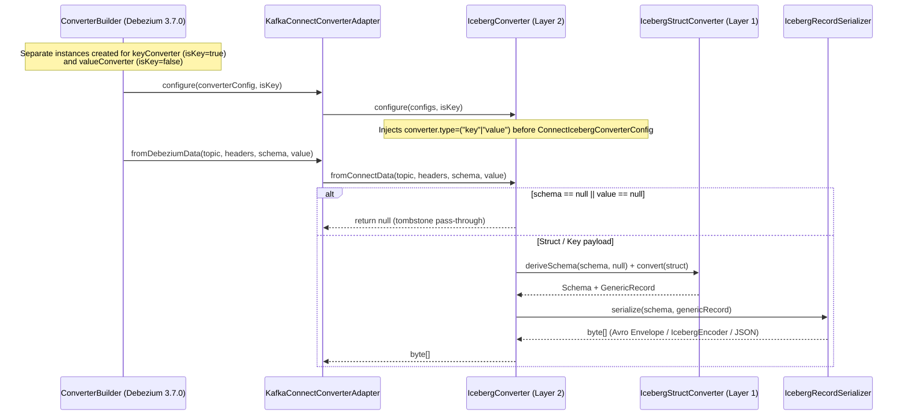

# ADR-0002: Pluggable Iceberg Converter (Module Extraction & Two-Layer Design)

* **Status**: Accepted
* **Date**: 2026-11-19
* **Issues**: [#798](https://github.com/memiiso/debezium-server-iceberg/issues/798)
* **Numbering Note**: `ADR-0001` is reserved for `docs/adr/0001-multi-table-transaction.md` on `feat/773-multi-table-transaction` (PR #783) to prevent merge conflicts when PR #783 is merged into `master`.

---

## 1. Context & Problem Statement

### 1.1 Goal (Issue #798)

Users running **Debezium Server** (`debezium.format.value=clientprovided`), **Debezium Embedded** (`DebeziumEngine`), or **Kafka Connect** want to convert Debezium CDC events directly into Apache Iceberg `Schema`, `SortOrder`, and `GenericRecord` instances without pulling Quarkus, `debezium-server-core`, Hadoop, Hive, Spark, or JSON serialization overhead.

The repository already contains battle-tested Kafka Connect `Schema`/`Struct` to Iceberg `Schema`/`GenericRecord` conversion logic in `debezium-server-iceberg-sink` (`StructSchemaConverter`, `StructEventConverter`, `DateTimeUtils`, `StructVariantObject`, `geospatial/*`). However, that conversion code is currently trapped inside the Quarkus-based sink module.

### 1.2 Upstream Debezium Context (`2027 Roadmap` & `dbz#74`)

1. **Debezium 2027 Roadmap** ([Zulip discussion](https://debezium.zulipchat.com/#narrow/channel/302533-dev/topic/Debezium.202027.20Roadmap/near/635447725), quoted in [#798](https://github.com/memiiso/debezium-server-iceberg/issues/798)):
   > *"On the pluggable event format, this should already be doable by specifying converter.class that points to your implementation of your Converter implementation. This follows a similar premise if you wanted to emit CloudEvents converter. In Debezium server, you'd accompany this as: `debezium.format.[key|value|header]=clientprovided`, `debezium.format.[key|value|header].class=<fully qualified class path name>`"*
2. **Upstream `debezium/dbz#74` (`DBZ-8967`) / PR `debezium/debezium#7214`**:
   Introduces `EnvelopeSchemaFactory` (`envelope.schema.factory`) at the `Envelope` / `TableSchemaBuilder` level to let connectors emit custom or pre-flattened schemas without per-record `ExtractNewRecordState` SMT reconstruction overhead. While `dbz#74` optimizes upstream schema construction, it does **not** alter `org.apache.kafka.connect.storage.Converter` or `io.debezium.engine.converter.Converter` contracts, which both return `byte[]` in Debezium `3.7.0.Final`.

### 1.3 Current Architecture & Coupling on `master`

Inspection of `master` (`0230fb6`) and Debezium `3.7.0.Final` reveals five structural couplings that block direct reuse:

1. **Quarkus / SmallRye Config Coupling**:
   - `StructSchemaConverter` (`lines 30, 32, 86, 98, 104, 112, 223, 242, 297`), `AbstractEventConverter` (`lines 59, 69, 130, 137, 184`), and `StructEventConverter` (`lines 55–64, 104, 135–166, 263, 353`) accept `GlobalConfig` (`@ConfigRoot @ConfigMapping`).
   - `GeospatialTypes` (`lines 36, 48, 74`) accepts `IcebergConfig` (`@ConfigRoot @ConfigMapping`), and `validateConfig(IcebergConfig)` mixes CRS validation with sink-only `writeFormat()` (`!= orc`) and `formatVersion()` (`>= 3`).
   - `StructSchemaConverter` (`line 370`) and `AbstractEventConverter` (`line 373`) reference `DebeziumConfig.TS_MS_FIELDS`, and `StructSchemaConverter` (`lines 223, 297`) calls `DebeziumConfig.isEventFlatteningEnabled()`, which inspects `debezium.transforms` and `debezium.transforms.<name>.type` — properties unavailable inside Kafka Connect `Converter.configure(Map<String, ?>, boolean)`.
2. **Mixed JSON / `DebeziumSerdes` State in `AbstractEventConverter` & `StructEventConverter`**:
   - `AbstractEventConverter` (`lines 61–82`) owns static `ObjectMapper`, `DebeziumSerdes.payloadJson(JsonNode.class)` serdes/deserializers, unused `VARIANT_EMPTY_METADATA`, and unused `JsonConverter` (`lines 65, 80–81`), while `lines 84–380` hold pure value/temporal/decimal conversion logic shared by both `StructEventConverter` and `JsonEventConverter`.
   - `StructEventConverter` (`lines 52–53`) declares unused `DebeziumSerdes.payloadJson(Struct.class)` static fields (`eventSerde`, `structSerializer`).
3. **Sink Write-Path Coupling in `StructEventConverter`**:
   - `StructEventConverter` implements `EventConverter`, tying pure `Struct -> GenericRecord` conversion (`lines 247–385`) to sink-only `BatchEvent`, `EmbeddedEngineChangeEvent`, `RecordWrapper`, `Operation`, `cdcOpField`, `cdcSourceTsField`, and `isNewKey`.
4. **Package-Visibility & `JsonNode` Leakage**:
   - `DateTimeUtils.timestampFromMillis`, `timestamptzFromNanos`, and `timestamptzFromMillis` (`lines 102, 106, 110`) are `protected static` (package-private) while `JsonEventConverter:365` calls `DateTimeUtils.timestamptzFromMillis`.
   - `AbstractVariantObject.metadata` (`line 31`) is `protected final` and accessed directly as `val.metadata` by `JsonEventConverter:435` instead of `val.metadata()` (`line 38`).
   - `GeospatialValues.fromJson(JsonNode, ...)` (`lines 64–85`) pulls Jackson `JsonNode` into `converter.geospatial`, even though only `JsonEventConverter` calls it.
5. **Debezium `3.7.0.Final` `Converter` `byte[]` & Single-Payload Boundary**:
   - In `debezium-api:3.7.0.Final`, `io.debezium.engine.converter.Converter.fromDebeziumData(...)` returns `byte[]`.
   - In `debezium-embedded:3.7.0.Final`, `ConverterBuilder.toFormat(...)` invokes `keyConverter` and `valueConverter` separately for `ClientProvided.class`, returning `byte[]` in `EmbeddedEngineChangeEvent` (whereas `Connect.class` bypasses `ConverterBuilder` converters and delivers the raw `SourceRecord` containing both `keySchema` and `valueSchema`).
   - Consequently, a Kafka Connect `value.converter` alone cannot see `keySchema` to derive Iceberg `identifierFieldIds` or `SortOrder`, and cannot return an in-memory `GenericRecord` without serialization.

---

## 2. Decision Drivers & Considered Options

### 2.1 Decision Drivers

- **Zero heavy dependencies for library consumers**: Embedded and Kafka Connect users must be able to depend on the converter without Quarkus, `debezium-server-core`, `debezium-embedded`, Hadoop, Hive, Spark, Parquet, ORC, or `DebeziumSerdes`.
- **Zero performance regression for `debezium-server-iceberg-sink`**: The sink must continue converting `SourceRecord`/`Struct` to `GenericRecord` in memory with **zero** `byte[]` serialization/deserialization overhead when using `debezium.format.value=connect`.
- **Full `keySchema` + `valueSchema` fidelity**: Primary keys (`identifierFieldIds`) and `SortOrder` require joint inspection of `keySchema` and `valueSchema`.
- **First-class `Converter` pluggability**: Must work out-of-the-box with `debezium.format.value=clientprovided` + `debezium.format.value.class=io.debezium.converters.iceberg.IcebergConverter` and Kafka Connect (`Converter`, `Versioned`, `ConfigDescriptor`, `META-INF/services`).
- **Clean evolution with Debezium upstream**: Ready for `dbz#74` (`EnvelopeSchemaFactory`) and any future Debezium non-`byte[]` converter SPI.
- **Backward compatibility for sink users**: All existing `debezium.sink.iceberg.*` and `debezium.source.*` SmallRye properties and `json` / `connect` sink modes must remain unchanged.

### 2.2 Considered Options

#### Module Structure Options

| Option | Description | Assessment |
| :--- | :--- | :--- |
| **Option 2A (Chosen)** | Extract a pure-Java **`debezium-iceberg-converter`** Maven module (`io.debezium.converters.iceberg`) as a dependency of `debezium-server-iceberg-sink`. | Clean dependency boundary (`iceberg-core`, `debezium-connector-common` [without `DebeziumSerdes`], `debezium-config`, `debezium-util`, `connect-api`); automatically included in `debezium-server-iceberg-dist` transitively. |
| Option 2B (Rejected) | Keep converter inside `debezium-server-iceberg-sink`. | Forces Quarkus, Hadoop, Hive, Spark, and `debezium-server-core` onto Debezium Embedded and Kafka Connect classpaths. |

#### API Design Options

| Option | Description | Assessment |
| :--- | :--- | :--- |
| Option 3A (Rejected) | Single-layer `org.apache.kafka.connect.storage.Converter` only. | Forces `byte[]` serialization/deserialization inside `debezium-server-iceberg-sink` and Debezium Embedded `Connect.class`, and loses `keySchema` visibility for `identifierFieldIds` inside `value.converter`. |
| **Option 3B (Chosen)** | **Two-Layer Design**: Layer 1 core in-memory API (`SourceRecord` / `(Schema, Schema, Struct)` -> `Schema`, `SortOrder`, `GenericRecord`) + Layer 2 `IcebergConverter implements Converter` wrapping Layer 1 with pluggable `byte[]` serialization. | Zero-copy in-memory conversion with full PK/`SortOrder` support for the sink and Embedded `Connect.class` today, plus standard `Converter` pluggability for `clientprovided` / Kafka Connect today. |

---

## 3. Option 2A — Maven Module Restructuring

### 3.1 Three-Module Reactor Layout

```text
debezium-server-iceberg (root pom.xml, parent: io.debezium:debezium-build-parent:3.7.0.Final)
├── debezium-iceberg-converter          [NEW] Pure Java converter library (Layer 1 + Layer 2)
├── debezium-server-iceberg-sink        Depends on debezium-iceberg-converter; Quarkus sink + JSON mode
└── debezium-server-iceberg-dist        Unchanged pom.xml; packages converter transitively via sink
```



### 3.2 Dependency Specification for `debezium-iceberg-converter`

Verified against local Maven artifacts (`3.7.0.Final` and `1.12.0` in `~/.m2/repository`):

| Dependency (`groupId:artifactId`) | Version / BOM | Scope | Exact Purpose & Notes |
| :--- | :--- | :--- | :--- |
| `org.apache.iceberg:iceberg-core` | `iceberg-bom:1.12.0` | `compile` | Houses `GenericRecord`, `Variants`, `ShreddedObject`, `SchemaParser`, `IcebergEncoder`, `IcebergDecoder` (and `compile` `iceberg-api` + `avro`; `runtime` `iceberg-common`, `iceberg-bundled-guava`, `caffeine`, `jackson-*`). **Zero Hadoop, Hive, Spark, Parquet, or ORC.** |
| `io.debezium:debezium-connector-common` | `debezium-bom:3.7.0.Final` | `compile` | Houses `io.debezium.time.*`, `io.debezium.data.Uuid`, `TemporalPrecisionMode`, `ConfigDescriptor` (note: `debezium-core` does **not** exist in Debezium `3.7.0.Final`). Pulls `debezium-api`, `debezium-util` (`DebeziumException`), `debezium-config` (`Field`, `Configuration`). |
| `org.apache.kafka:connect-api` | `debezium-bom` (`4.3.1`) | `compile` | Required because `debezium-connector-common` declares `connect-api` as `provided`, and `IcebergConverter implements Converter` + `ConnectIcebergConverterConfig extends ConverterConfig` are public APIs. |
| `org.slf4j:slf4j-api` | `debezium-server-bom` (`2.0.17`) | `compile` | Logging (`debezium-connector-common` marks `slf4j-api` as `provided`; `quarkus-bom` inside `debezium-server-bom` overrides `debezium-build-parent`'s `1.7.36` to `2.0.17`). |
| `org.junit.jupiter:junit-jupiter`, `org.mockito:mockito-core`, `org.mockito:mockito-junit-jupiter` | BOM | `test` | Pure JUnit 5 + Mockito unit testing without Quarkus or Testcontainers. |
| `org.apache.iceberg:iceberg-parquet` | `iceberg-bom:1.12.0` | `test` | Optional test-only dependency for Parquet write/read round-trip tests (e.g., `WkbConverterTest` / geospatial converter verification). |

**Strict Forbidden Dependency Boundary**:
- `debezium-iceberg-converter` must have **zero** dependencies on Quarkus, SmallRye Config, `debezium-server-core`, `debezium-embedded`, `hadoop-*`, `hive-*`, `spark-*`, `iceberg-orc`, or `iceberg-aws/gcp/azure`.
- **No `DebeziumSerdes` imports**: `io.debezium.serde.DebeziumSerdes` resides inside `debezium-connector-common`; `debezium-iceberg-converter` must never import `io.debezium.serde.*` (enforced by code review / optional ArchUnit or import check).
- **Avoid `iceberg-bundled-guava` compile coupling**: `StructEventConverter` (`line 26`) and `StructVariantObject` (`line 27`) currently import `org.apache.iceberg.relocated.com.google.common.base.Preconditions`, while `iceberg-core:1.12.0` declares `iceberg-bundled-guava` in `runtime` scope. Moving `StructVariantObject` and `IcebergStructConverter` into `debezium-iceberg-converter` should replace `Preconditions.checkArgument(...)` with standard JDK checks (`Objects.requireNonNull` / `if (...) throw new IllegalArgumentException(...)`) so `debezium-iceberg-converter` does not need a direct compile dependency on `iceberg-bundled-guava`.
- **Why `debezium-server-iceberg-dist` requires zero `pom.xml` changes**:
  In `debezium-server-iceberg-dist/pom.xml` (`lines 95–191`), the `assembly` profile depends on `debezium-server-iceberg-sink:${revision}` and runs `maven-assembly-plugin` with `src/main/resources/assemblies/server-distribution.xml`. That descriptor (`lines 20–39`) copies `<scope>runtime</scope>` dependencies with `<useTransitiveFiltering>true</useTransitiveFiltering>` into `${project.parent.artifactId}/lib/`. Adding `debezium-iceberg-converter:${revision}` as a compile dependency of `debezium-server-iceberg-sink` automatically bundles `debezium-iceberg-converter-*.jar` into the distribution archive.

### 3.3 Complete Class-Move, Split & Visibility Mapping

| Current Class (`debezium-server-iceberg-sink` `.../converter/`) | Target Module & Package | Action & Exact Refactoring Details |
| :--- | :--- | :--- |
| `IcebergSchemaInfo.java` | `debezium-iceberg-converter` (`io.debezium.converters.iceberg`) | **Move as-is** (update package). |
| `SchemaConverter.java` | `debezium-iceberg-converter` (`io.debezium.converters.iceberg`) | **Move as-is** (update package; `JsonSchemaConverter` in sink implements it). |
| `DateTimeUtils.java` | `debezium-iceberg-converter` (`io.debezium.converters.iceberg`) | **Move & fix visibility**: change `timestampFromMillis` (`line 102`), `timestamptzFromNanos` (`line 106`), and `timestamptzFromMillis` (`line 110`) from `protected static` to `public static` so `JsonEventConverter:365` in the sink package can call `timestamptzFromMillis`. |
| `AbstractVariantObject.java` | `debezium-iceberg-converter` (`io.debezium.converters.iceberg`) | **Move** (update package; update `JsonEventConverter:435` from `val.metadata` to `val.metadata()`). |
| `StructVariantObject.java` | `debezium-iceberg-converter` (`io.debezium.converters.iceberg`) | **Move** (update package; replace `Preconditions.checkArgument` with standard `IllegalArgumentException` checks). |
| `geospatial/WkbConverter.java` | `debezium-iceberg-converter` (`io.debezium.converters.iceberg.geospatial`) | **Move as-is** (update package). |
| `geospatial/GeospatialTypes.java` | **Split**: `debezium-iceberg-converter` + sink validator | **Move** `icebergType`, `isGeospatialType`, `srid`, `isGeospatial`, and `validateCrs(String)` to `io.debezium.converters.iceberg.geospatial.GeospatialTypes`, taking `IcebergConverterConfig` instead of `IcebergConfig` (`lines 36, 48`). **Keep** sink-only `writeFormat != orc` and `formatVersion >= 3` validation (`lines 74–102`) in sink (e.g., `IcebergUtil.validateGeospatialConfig(IcebergConfig)` called from `IcebergChangeConsumer.connect()`). |
| `geospatial/GeospatialValues.java` | **Split**: `debezium-iceberg-converter` + `JsonGeospatialValues` (sink) | **Move** `fromStruct`, `sridMatchesCrs`, `checkSrid` (make `public`), and `toIsoWkb` (make `public`) to `io.debezium.converters.iceberg.geospatial.GeospatialValues`; generalize error messages at `lines 99–105` so they do not hardcode `debezium.sink.iceberg.*`. **Move** `fromJson(JsonNode, ...)` (`lines 64–85`) to sink `JsonGeospatialValues.fromJson(...)`, delegating to `GeospatialValues.toIsoWkb` and `GeospatialValues.checkSrid`. |
| `StructSchemaConverter.java` | `debezium-iceberg-converter` (`io.debezium.converters.iceberg`) | **Move & decouple**: replace `GlobalConfig` (`lines 30, 32, 86, 98, 104, 112, 223, 242, 297`) with `IcebergConverterConfig`; replace `DebeziumConfig.TS_MS_FIELDS` (`line 370`) with `IcebergConverterConfig.TS_MS_FIELDS`; generalize `line 308` error message (neutralize `debezium.sink.iceberg.create-identifier-fields=false` hint to reference converter config). Note on `isAdaptiveTemporalMode()`: `StructSchemaConverter:368–385` currently does not check `isAdaptiveTemporalMode()` (unlike `JsonSchemaConverter:324–326`); preserve `StructSchemaConverter` behavior by default in Phase 1 (see §4.4 & §6.3). |
| `AbstractEventConverter.java` | **Split**: `IcebergValueConverter` (`debezium-iceberg-converter`) + `AbstractEventConverter` (sink) | **Extract** pure value conversion (`lines 84–380`: `convertDecimal`, `convertLocalDateTime`, `convertOffsetDateTime`, `convertInt/Long/Float/Double/Boolean/String/UUID/Binary`, `convertDateValue`, `convertTimeValue`, `convertTimestampValue`) into `IcebergValueConverter` taking `IcebergConverterConfig` (replace `ConnectException` at `line 363` with `IllegalArgumentException` or `DataException`). **Keep** `AbstractEventConverter extends IcebergValueConverter` in sink holding only `config`, `mapper`, `valSerde`, `keySerde`, `valDeserializer`, `keyDeserializer`, and `initializeStaticSerdes()` (`lines 59–82`); **delete dead fields** `VARIANT_EMPTY_METADATA` (`line 62`) and `jsonConverter` (`lines 65, 80–81`). |
| `StructEventConverter.java` | **Split**: `IcebergStructConverter` (Layer 1, `debezium-iceberg-converter`) + thin `StructEventConverter` (sink) | **Extract** `convertToIcebergRecord`, `convertValue`, `convertListValue`, `convertMapValue` (`lines 247–385`, replacing `Preconditions.checkArgument` with standard checks) and `isSchemaChangeEvent(Schema)` (`lines 197–201`) into Layer 1 (`IcebergStructConverter`) backed by `IcebergValueConverter` + `StructSchemaConverter`. **Simplify** `StructEventConverter` in sink to a thin `EventConverter` adapter wrapping `(EmbeddedEngineChangeEvent | BatchEvent | SourceRecord)` + `SinkIcebergConverterConfig`, extracting `cdcOpValue()` / `cdcSourceTsValue()`, delegating schema & record conversion to Layer 1, and wrapping `GenericRecord` in `RecordWrapper`. **Delete dead fields** `eventSerde` & `structSerializer` (`lines 52–53`). |
| `EventConverter.java` | `debezium-server-iceberg-sink` | **Keep** in sink (coupled to `RecordWrapper`, `Operation`, `jakarta.annotation`, and `BatchDeduplicator`); add `import io.debezium.converters.iceberg.SchemaConverter;` (`line 72`) and update `IcebergTableOperator.java` (`line 19`, used at `lines 140, 150`) to import the relocated `SchemaConverter`. |
| `JsonEventConverter.java` | `debezium-server-iceberg-sink` | **Keep** in sink; update imports (`DateTimeUtils`, `GeospatialTypes`, `AbstractVariantObject`, `JsonGeospatialValues`), replace `val.metadata` (`line 435`) with `val.metadata()`, and pass `config` to `super(config)`. |
| `JsonSchemaConverter.java` | `debezium-server-iceberg-sink` | **Keep** in sink; update imports (`SchemaConverter`, `IcebergSchemaInfo`, `GeospatialTypes`), pass `SinkIcebergConverterConfig` (or adapter) to `GeospatialTypes`. |
| `JsonVariantObject.java` | `debezium-server-iceberg-sink` | **Keep** in sink; update `AbstractVariantObject` import to `io.debezium.converters.iceberg`. |
| *(New)* Layer 1 + Layer 2 + Config classes | `debezium-iceberg-converter` (`io.debezium.converters.iceberg` & `.spi`) | `IcebergConverterConfig`, `ConnectIcebergConverterConfig`, `IcebergValueConverter`, `IcebergStructConverter`, `ConvertedIcebergRecord`, `IcebergConverter`, `IcebergRecordSerializer` SPI + implementations. |
| *(New)* `SinkIcebergConverterConfig` | `debezium-server-iceberg-sink` (`io.debezium.server.iceberg.converter`) | Adapts `GlobalConfig` (`IcebergConfig` + `DebeziumConfig`) to `IcebergConverterConfig`. |

---

## 4. Configuration Design & `GlobalConfig` Adaptation

### 4.1 Pure-Java `IcebergConverterConfig` Contract

In `io.debezium.converters.iceberg`, `IcebergConverterConfig` is a **pure-Java interface** with zero Quarkus or SmallRye annotations:

```java
package io.debezium.converters.iceberg;

import io.debezium.jdbc.TemporalPrecisionMode;
import java.util.Collections;
import java.util.List;
import org.apache.iceberg.types.Types;

public interface IcebergConverterConfig {

  List<String> TS_MS_FIELDS = List.of("__ts_ms", "__source_ts_ms");

  default TemporalPrecisionMode temporalPrecisionMode() {
    return TemporalPrecisionMode.ISOSTRING;
  }

  default boolean eventFlatteningEnabled() {
    return true;
  }

  default boolean createIdentifierFields() {
    return true;
  }

  default boolean preserveRequiredProperty() {
    return false;
  }

  default boolean replaceNullWithDefault() {
    return false;
  }

  default boolean nestedAsVariant() {
    return false;
  }

  default List<String> excludedColumns() {
    return Collections.emptyList();
  }

  default boolean geospatialTypesEnabled() {
    return false;
  }

  default String geometryCrs() {
    return Types.GeometryType.DEFAULT_CRS;
  }

  default boolean geospatialAllowMissingSrid() {
    return false;
  }
}
```

Two concrete implementations live alongside it:
1. **`ConnectIcebergConverterConfig extends ConverterConfig implements IcebergConverterConfig`** (in `debezium-iceberg-converter`):
   - Extends `org.apache.kafka.connect.storage.ConverterConfig`, defining `io.debezium.config.Field` constants and a `static final ConfigDef CONFIG = ConverterConfig.newConfigDef()` patterned on `CloudEventsConverterConfig`.
   - Also provides a convenient pure-Java `Builder` / `fromMap(Map<String, ?>)` factory (auto-injecting `converter.type=value` internally) so Layer 1 Embedded users do not have to supply Kafka Connect's mandatory `converter.type` key manually.
   - Adds Layer 2 serialization fields (`serializer.type`, `schema.cache.size`, `avro.schema.store.class` — see §5.4).
2. **`SinkIcebergConverterConfig implements IcebergConverterConfig`** (in `debezium-server-iceberg-sink`):
   - Lightweight wrapper around `GlobalConfig` delegating directly to `globalConfig.iceberg().*` and `globalConfig.debezium().temporalPrecisionMode()` / `globalConfig.debezium().isEventFlatteningEnabled()`.
   - Preserves **100% backward compatibility** for all `debezium.sink.iceberg.*` and `debezium.source.*` SmallRye properties and existing Mockito-based unit tests.

### 4.2 Complete Property-by-Property Mapping (`master` Baseline)

#### A. `IcebergConfig` (`debezium-server-iceberg-sink/.../IcebergConfig.java`)

| Sink Property (`@WithName`) | Sink Method (`master` lines) | Converter Field (`ConnectIcebergConverterConfig`) | Default (Sink / Converter) | Scope & Notes |
| :--- | :--- | :--- | :--- | :--- |
| `debezium.sink.iceberg.create-identifier-fields` | `createIdentifierFields()` `:83–85` | `create.identifier.fields` | `true` / `true` | Controls PK `identifierFieldIds` derivation. Note: suppressed automatically when `nestedAsVariant=true` (`IcebergChangeConsumer:343–347`). |
| `debezium.sink.iceberg.excluded-columns` | `excludedColumns()` `:95–96` | `excluded.columns` | empty / empty | Top-level columns excluded from converted Iceberg `Schema` and `GenericRecord`. |
| `debezium.sink.iceberg.preserve-required-property` | `preserveRequiredProperty()` `:102–104` | `preserve.required.property` | `false` / `false` | Preserves Connect `Schema.isOptional()` vs requiring only PK fields. |
| `debezium.sink.iceberg.replace-null-with-default` | `replaceNullWithDefault()` `:106–108` | `replace.null.with.default` | `false` / `false` | Uses `struct.get(field)` vs `struct.getWithoutDefault(field.name())` (`StructEventConverter:263`). |
| `debezium.sink.iceberg.nested-as-variant` | `nestedAsVariant()` `:110–112` | `nested.as.variant` | `false` / `false` | Maps nested `STRUCT` fields to Iceberg v3 `Types.VariantType` via `StructVariantObject`. Sink also forces table `format-version=3` (`IcebergChangeConsumer:376–377`). |
| `debezium.sink.iceberg.geospatial-types-enabled` | `geospatialTypesEnabled()` `:114–116` | `geospatial.types.enabled` | `false` / `false` | Enables Iceberg v3 `GeometryType`/`GeographyType` (`GeospatialTypes:37`). |
| `debezium.sink.iceberg.geometry-crs` | `geometryCrs()` `:118–120` | `geometry.crs` | `OGC:CRS84` | Target CRS for `GeometryType`; validated by `GeospatialTypes.validateCrs(String)`. |
| `debezium.sink.iceberg.geospatial-allow-missing-srid` | `geospatialAllowMissingSrid()` `:122–124` | `geospatial.allow.missing.srid` | `false` / `false` | Controls missing/0 SRID handling in `GeospatialValues.fromStruct`. |
| `debezium.sink.iceberg.upsert-op-field` | `cdcOpField()` `:27–29` | — | `"__op"` | **Sink-only**: used by `StructEventConverter.cdcOpValue()` / `JsonEventConverter.cdcOpValue()`. |
| `debezium.sink.iceberg.upsert-dedup-column` | `cdcSourceTsField()` `:31–32` | — | empty | **Sink-only**: used by `cdcSourceTsValue()` & `TimestampAndOpBatchDeduplicator`. |
| `debezium.sink.iceberg.deduplicator` | `deduplicator()` `:34–35` | — | empty | **Sink-only**: `IcebergTableOperator` batch deduplication strategy. |
| `debezium.sink.iceberg.upsert` | `upsert()` `:37–39` | — | `false` | **Sink-only**: Iceberg equality-delete vs append write mode. |
| `debezium.sink.iceberg.upsert-keep-deletes` | `keepDeletes()` `:41–43` | — | `true` | **Sink-only**: `IcebergTableWriterFactory` delta writer behavior. |
| `debezium.sink.iceberg.upsert-use-dv` | `useDv()` `:45–46` | — | empty | **Sink-only**: Iceberg v3 Deletion Vectors toggle. |
| `debezium.sink.iceberg.write.format.default` | `writeFormat()` `:87–89` | — | `"parquet"` | **Sink-only**: table property + sink startup check (`!= orc` when geospatial enabled). |
| `debezium.sink.iceberg.format-version` | `formatVersion()` `:126–128` | — | `"3"` | **Sink-only**: table property + sink startup check (`>= 3` when geospatial enabled). |
| `debezium.sink.iceberg.allow-field-addition` | `allowFieldAddition()` `:91–93` | — | `true` | **Sink-only**: catalog `updateSchema()` evolution. |
| `debezium.sink.iceberg.partition-by` (+ `.partition-by.<dest>`) | `partitionBy()`, `partitionByForTable()`, `isPartitionByTableSpecific()` `:24–25, 135–152` | — | empty | **Sink-only**: `PartitionSpec` creation via `ConfigProvider.getConfig()`. |
| `debezium.sink.iceberg` (map), `warehouse`, `io-impl`, `catalog-name`, `table-namespace`, `table-mapper`, `destination-*`, `table-prefix`, `openlineage-enabled` | `:21–22, 48–81, 98–100, 130–132` | — | various | **Sink-only**: catalog, FileIO, table name mapping, and OpenLineage integration. |

#### B. `DebeziumConfig`, `BatchConfig`, `GlobalConfig`, & `BaseIcebergStorageConfig`

| Source Class & Property | Method / Field (`master` lines) | Converter Field (`ConnectIcebergConverterConfig`) | Default (Sink / Converter) | Scope & Notes |
| :--- | :--- | :--- | :--- | :--- |
| `DebeziumConfig.TS_MS_FIELDS` | `TS_MS_FIELDS` `:17` | `IcebergConverterConfig.TS_MS_FIELDS` | `["__ts_ms", "__source_ts_ms"]` | Moved as constant to `IcebergConverterConfig`. |
| `debezium.source.time.precision.mode` | `temporalPrecisionMode()` `:19–21` | `temporal.precision.mode` | `isostring` / `isostring` | Fallback precision for untyped `Long`/`String` temporals in `IcebergValueConverter`. |
| `debezium.transforms` + `debezium.transforms.<name>.type` | `isEventFlatteningEnabled()` `:139–155` | `event.flattening.enabled` | `true` (via `unwrap`) / `true` | See §4.3 below for standalone default and unflattened envelope handling. |
| `debezium.source.time.precision.mode.adaptive-allowed` | `temporalPrecisionModeAdaptiveAllowed()` `:23–25`, `isAdaptiveTemporalMode()` `:103–106` | *(optional / see §4.4)* | `false` | `JsonSchemaConverter:324` uses `isAdaptiveTemporalMode()`; `StructSchemaConverter` does not. Startup validation stays in `IcebergChangeConsumer.connect()`. |
| `debezium.source.decimal.handling.mode` | `decimalHandlingMode()` `:27–29` | — | `double` | **Source/Sink-only**: never read by converters (converters handle both numeric and `Decimal` bytes). |
| `debezium.format.{value,key}` & `.schemas.enable` | `:32–46, 108–126` | — | `connect` / `true` | **Server/Sink-only**: sink `keyValueChangeEventFormat()` restricts sink consumption to `{json, connect}`. |
| `debezium.source.offset.*`, `schema.history.*`, `topic.heartbeat.*` | `:50–65, 91–97` | — | — | **Source/Sink-only**: `BaseIcebergStorageConfig`, `IcebergOffsetBackingStore`, `IcebergSchemaHistory`, heartbeat skip. |
| `BatchConfig.*` & `GlobalConfig.quarkusLogLevel()` | `BatchConfig:11–47`, `GlobalConfig:23–25` | — | — | **Sink-only**: batching, parallel upload semaphore, Quarkus log level. |

### 4.3 `event.flattening.enabled` Interaction with `create.identifier.fields`

In the sink, `DebeziumConfig` defaults `debezium.transforms=unwrap` (`io.debezium.transforms.ExtractNewRecordState`), so `isEventFlatteningEnabled()` defaults to `true`. In standalone Kafka Connect or Debezium Embedded (`Converter.configure`), `debezium.transforms.*` is never passed to the converter's config map.

Therefore:
- `ConnectIcebergConverterConfig` exposes `event.flattening.enabled` (default `true`, matching the sink convention when `ExtractNewRecordState` is configured).
- When `event.flattening.enabled=false` (unwrapped/raw Debezium `Envelope` events) AND `create.identifier.fields=true` AND `keySchema != null`, `StructSchemaConverter.icebergSchema(true)` throws `DebeziumException` with a config-neutral message instructing callers to enable event flattening (`ExtractNewRecordState`) or set `create.identifier.fields=false`.
- `SinkIcebergConverterConfig` bridges `eventFlatteningEnabled()` directly to `globalConfig.debezium().isEventFlatteningEnabled()`, preserving exact sink behavior.

### 4.4 `createIdentifierFields` + `nestedAsVariant` & `isAdaptiveTemporalMode` Notes

1. **`createIdentifierFields` + `nestedAsVariant` interaction**: As implemented in `IcebergChangeConsumer:343–347`, Iceberg does not support identifier fields when nested structs are mapped as `VariantType`. Layer 1 exposes `icebergSchema(boolean withIdentifierFields)` on `StructSchemaConverter` (explicit control, used by the sink) while `IcebergStructConverter.convert(SourceRecord)` computes `boolean effectiveIdentifierFields = config.createIdentifierFields() && !config.nestedAsVariant() && !isSchemaChangeEvent(valueSchema) && keySchema != null`, logging the existing warning once per schema if `createIdentifierFields && nestedAsVariant`. When `effectiveIdentifierFields == false`, `SortOrder.unsorted()` is returned (matching `IcebergChangeConsumer:342, 347, 357`), and `isSchemaChangeEvent(Schema valueSchema)` guards `valueSchema != null && valueSchema.type() == Schema.Type.STRUCT`.
2. **`isAdaptiveTemporalMode()` divergence**: `JsonSchemaConverter:324–326` emits `Types.LongType.get()` for `int64` when `isAdaptiveTemporalMode()` is true, whereas `StructSchemaConverter:368–385` maps `Timestamp`/`MicroTimestamp`/`NanoTimestamp` logical schemas to `Types.TimestampType.withoutZone()` regardless of `temporalPrecisionMode`. Phase 1 preserves existing `StructSchemaConverter` behavior so Connect-format tests remain 100% unchanged; aligning adaptive mode for Connect format can be evaluated separately if needed.

---

## 5. Option 3B — Two-Layer Converter Design

### 5.1 Overall Architecture



### 5.2 Execution Sequences

#### Path A: Zero-Serialization In-Memory Conversion (Sink & Debezium Embedded `Connect.class`)



#### Path B: Pluggable `Converter` (`debezium.format.value=clientprovided` / Kafka Connect)



### 5.3 Layer 1: Core In-Memory Converter API (`io.debezium.converters.iceberg`)

#### Concrete Public API

```java
package io.debezium.converters.iceberg;

public record ConvertedIcebergRecord(
    String destination,
    org.apache.iceberg.Schema schema,
    org.apache.iceberg.SortOrder sortOrder,
    org.apache.iceberg.data.GenericRecord record,
    boolean schemaChangeEvent) {}

public class IcebergStructConverter {

  public IcebergStructConverter(IcebergConverterConfig config);
  public IcebergStructConverter(IcebergConverterConfig config, int maxSchemaCacheSize);

  /** Converts a full SourceRecord (using both keySchema and valueSchema). */
  public ConvertedIcebergRecord convert(SourceRecord sourceRecord);

  /** Low-level schema converter lookup/creation (cached by valueSchema + keySchema). */
  public StructSchemaConverter schemaConverter(Schema valueSchema, Schema keySchema);

  /** Direct in-memory conversion into a caller-supplied Iceberg struct schema (used by sink). */
  public GenericRecord convertToIcebergRecord(
      Types.StructType icebergStructSchema, Struct connectStruct);

  /** Checks whether a Connect value schema represents a Debezium DDL/schema-change event. */
  public static boolean isSchemaChangeEvent(Schema valueSchema);
}
```

#### Key Design Properties of Layer 1

1. **Zero serialization**: Operates directly on `org.apache.kafka.connect.source.SourceRecord` and `org.apache.kafka.connect.data.Struct` in memory, returning `org.apache.iceberg.data.GenericRecord` and `org.apache.iceberg.Schema`.
2. **Schema Caching**: Caches derived `(Schema, SortOrder)` (or `StructSchemaConverter` + pre-computed `Schema` / `SortOrder`) keyed by `(valueSchema, keySchema)` using a bounded JDK `LinkedHashMap` / `ConcurrentHashMap` (default e.g. `1024` entries, configurable; note that `com.github.ben-manes.caffeine:caffeine` `3.2.3` is `runtime`-scoped in `iceberg-core:1.12.0`, so avoid Caffeine unless added explicitly as a `compile` dependency) — avoiding repeated field-ID traversal across batches of identical Connect schemas. Note: `StructSchemaConverter.equals`/`hashCode` uses `(valueSchema, keySchema)` directly, preserving `IcebergTableOperator`'s `Collectors.groupingBy(EventConverter::schemaConverter)` contract (`IcebergTableOperator.java`).
3. **Tombstones (`sourceRecord.value() == null`)**: `convert(SourceRecord)` returns a `ConvertedIcebergRecord` with `record == null` (preserving `schema` if `valueSchema != null`) rather than throwing, while sink `convertAsAppend` continues throwing on null `value` as tested today.
4. **Sink Integration (`debezium-server-iceberg-sink`)**:
   - `StructEventConverter` adapts `GlobalConfig` -> `SinkIcebergConverterConfig` and delegates `icebergSchema(boolean)`, `sortOrder(Schema)`, `isSchemaChangeEvent()`, and `convertToIcebergRecord(Types.StructType, Struct)` directly to Layer 1 (`StructSchemaConverter` + `IcebergStructConverter`), while keeping `EventConverter`, `RecordWrapper`, `Operation`, `cdcOpValue()`, `cdcSourceTsValue()`, `isNewKey`, and `destination()` in the sink.
   - `AbstractEventConverter` in sink extends `IcebergValueConverter` (reusing all primitive, decimal, temporal, UUID, and binary helpers) and keeps only the static `DebeziumSerdes` / `ObjectMapper` state needed by `JsonEventConverter`.
   - `IcebergChangeConsumer.handle()` and `DebeziumConfig.keyValueChangeEventFormat()` require **zero behavioral changes** for `connect` and `json` modes.
5. **Debezium Embedded (`Connect.class`) Consumer Usage Example**:

```java
IcebergConverterConfig converterConfig = ConnectIcebergConverterConfig.fromMap(Map.of(
    "create.identifier.fields", "true",
    "temporal.precision.mode", "isostring",
    "geospatial.types.enabled", "true"
));
IcebergStructConverter icebergConverter = new IcebergStructConverter(converterConfig);

DebeziumEngine<ChangeEvent<SourceRecord, SourceRecord>> engine =
    DebeziumEngine.create(Connect.class)
        .using(props)
        .notifying(record -> {
            SourceRecord sourceRecord = record.value();
            ConvertedIcebergRecord converted = icebergConverter.convert(sourceRecord);
            // converted.schema(), converted.sortOrder(), converted.record() (GenericRecord)
        })
        .build();
```

### 5.4 Layer 2: `IcebergConverter` (`org.apache.kafka.connect.storage.Converter`)

#### Class Contract & Pattern (`CloudEventsConverter` Alignment)

Following `io.debezium.converters.CloudEventsConverter` (`debezium-connect-plugins:3.7.0.Final`, lines `90`, `210–370`, `742–753`) and `ByteArrayConverter`:

```java
package io.debezium.converters.iceberg;

public class IcebergConverter implements Converter, Versioned, ConfigDescriptor {
  // Configures ConnectIcebergConverterConfig + IcebergStructConverter + IcebergRecordSerializer
}
```

#### Critical Mechanics & Edge Cases Verified Against Debezium `3.7.0.Final`

1. **Mandatory `ConverterConfig.TYPE_CONFIG` Injection in `configure(...)`**:
   - Verified in `debezium-embedded:3.7.0.Final` `ConverterBuilder.createConverter()` (`lines 202–252`): Debezium Embedded does **not** set `"converter.type"` when instantiating `KafkaConnectConverterAdapter` -> `converter.configure(converterConfig.asMap(), isKey)` (only `createHeaderConverter` sets `"converter.type", "header"` at `line 181`).
   - Because `ConverterConfig.newConfigDef()` defines `"converter.type"` with `ConfigDef.NO_DEFAULT_VALUE` (`ValidString.in("key", "value", "header")`), `IcebergConverter.configure(Map<String, ?> configs, boolean isKey)` **must** copy `configs` and inject `conf.put(ConverterConfig.TYPE_CONFIG, isKey ? ConverterType.KEY.getName() : ConverterType.VALUE.getName())` before instantiating `new ConnectIcebergConverterConfig(conf)` (mirroring `CloudEventsConverter.java:221`).
2. **Metadata, Discovery & Config Exposure**:
   - Overrides `public ConfigDef config()` returning `ConnectIcebergConverterConfig.configDef()` (matching `ByteArrayConverter`/`BinaryDataConverter`, improving on `CloudEventsConverter` which inherits an empty `ConfigDef`).
   - Implements `Versioned.version()` via a filtered `build.version` resource (matching `Module.version()` in `CloudEventsConverter:210–213`).
   - Implements `ConfigDescriptor.getConfigFields()` returning `Field.setOf(...)` of all converter `Field` constants (`CloudEventsConverter:742–753`).
   - Registers `io.debezium.converters.iceberg.IcebergConverter` in `META-INF/services/org.apache.kafka.connect.storage.Converter` (and optionally `ComponentMetadataProvider` in `META-INF/services/io.debezium.metadata.ComponentMetadataProvider` for Debezium metadata discovery).
3. **Key vs. Value Converter Separation (`isKey=true` vs `isKey=false`)**:
   - `ConverterBuilder` creates separate `keyConverter` (`isKey=true`) and `valueConverter` (`isKey=false`) instances with `converter.*` merged with `key.converter.*` or `value.converter.*` (in Debezium Server, `DebeziumServerConfigSourceFactory:78–83` remaps `debezium.format.{key,value}.*` to `quarkus.debezium.{key,value}.converter.*`).
   - Inside `fromConnectData(topic, headers, schema, value)`:
     - When `isKey == false` (`value.converter`): **only `valueSchema` and `value` are visible** — `record.keySchema()` is NOT passed to `value.converter`. Therefore, Layer 2 converts the value `Struct` with `keySchema = null` (unless key metadata is provided via a future header/config mechanism), meaning `identifierFieldIds` and `SortOrder` cannot be inferred inside `value.converter` alone. This is the primary structural reason Layer 1 remains essential!
     - When `isKey == true` (`key.converter`): handles both `Schema.Type.STRUCT` keys (via Layer 1) and primitive keys (wrapping or converting single primitive key schemas/values cleanly if a connector emits a non-struct key; note that wrapping a primitive key in a single-field `STRUCT` means `toConnectData` will round-trip it as a single-field `STRUCT` unless an explicit unwrap marker/header is included).
4. **`ConverterBuilder` & `DebeziumSerializationProducer` Configuration Pitfalls**:
   - **No `formatKey=connect` + `formatValue=clientprovided` mixing**: `ConverterBuilder.toFormat` (`line 87`) only bypasses converters when `formatValue == Connect.class`. Setting `debezium.format.value=clientprovided` with `debezium.format.key=connect` causes `createConverter(Connect.class, true)` to throw `DebeziumException("Converter 'Connect' is not supported")`. Users **must** set both `debezium.format.value=clientprovided` and a `Converter`-backed `debezium.format.key` (e.g., `clientprovided` or `json`).
   - **Case-sensitive `"clientprovided"` in Debezium Server**: `DebeziumSerializationProducer` (`lines 103–154`, `FORMAT_CLIENT_PROVIDED` at `lines 68, 130, 149`) matches `FORMAT_CLIENT_PROVIDED.equals(formatName)` using case-sensitive lowercase `"clientprovided"` (unlike `"connect"` which uses `equalsIgnoreCase`). Documentation and examples must strictly use lowercase `clientprovided`.
   - **Class property name**: In Debezium Server, set `debezium.format.value=clientprovided` + `debezium.format.value.class=io.debezium.converters.iceberg.IcebergConverter`; in Debezium Embedded, `ClientProvided.class` is selected programmatically via `DebeziumEngine.create(ClientProvided.class)` (or `KeyValueHeaderChangeEventFormat.of(...)`), while `Properties` configures `value.converter.class=io.debezium.converters.iceberg.IcebergConverter` (`ConverterBuilder:241–247`; `ConverterBuilder` never reads a `value.converter=org.apache.kafka.connect.storage.Converter` property).
5. **Tombstones & Non-Struct Values**:
   - If `schema == null || value == null`, `fromConnectData` returns `null` (matching `CloudEventsConverter:299–301`; `ConverterBuilder:127–132` passes `null` through without String conversion).
   - If `isKey == false` and `schema.type() != Schema.Type.STRUCT`, throw `DataException("Mismatching schema: expected STRUCT, got " + schema.type())`.

### 5.5 Layer 2 `byte[]` Serialization Options & Trade-Offs

Because `org.apache.kafka.connect.storage.Converter` and `io.debezium.engine.converter.Converter` strictly return `byte[]`, and `org.apache.iceberg.data.GenericRecord` does **not** implement `java.io.Serializable` (verified in `iceberg-core:1.12.0`; only `org.apache.iceberg.Schema` implements `Serializable`), Layer 2 must serialize `(Schema, GenericRecord)` into `byte[]`.

#### Comparison of Serialization Formats

| Option | Wire Format & Iceberg Primitives (`iceberg-core:1.12.0`) | Pros | Cons | `toConnectData` / Consumer Decode |
| :--- | :--- | :--- | :--- | :--- |
| **1. Self-Describing Iceberg Avro Envelope (`avro-envelope`) — Recommended Default** | Header `[magic 2B (e.g. 0x49 0x43) \| version 1B \| schemaJsonLen 4B \| SchemaParser.toJson(schema) UTF-8]` + Iceberg `DataWriter.create(AvroSchemaUtil.convert(schema, "table"))` binary Avro datum. | **Zero external Schema Registry**; pure `iceberg-core` (no new deps); preserves Iceberg field IDs, `identifierFieldIds`, logical types (`LocalDate`, `LocalTime`, `LocalDateTime`, `OffsetDateTime`, `BigDecimal`, `UUID`, `Variant`, ISO WKB `Geometry`/`Geography`); deterministic `GenericRecord` round-trip. | Repeats `SchemaParser.toJson(schema)` (~hundreds of bytes) per message. | **Fully self-describing**: `SchemaParser.fromJson(...)` + Iceberg `PlannedDataReader` / `RawDecoder` reconstructs exact `Schema` and `GenericRecord` (and `toConnectData` reconstructs Connect `SchemaAndValue`). |
| **2. Iceberg Single-Object Avro (`avro-single-object`)** | Built-in `org.apache.iceberg.data.avro.IcebergEncoder` / `IcebergDecoder`: 10-byte header (`0xC3 0x01` + 8-byte little-endian CRC-64-AVRO fingerprint) + `DataWriter` binary Avro payload. | Minimal 10-byte per-record overhead; built into `iceberg-core:1.12.0` with thread-local encoder buffers; native `SchemaStore` evolution support. | **Not self-describing on the wire**: `IcebergDecoder` throws `MissingSchemaException` unless the consumer/decoder has the write `Schema` pre-registered or via an out-of-band `SchemaStore`. | `IcebergDecoder(Schema readSchema, SchemaStore resolver)` requires a non-null `org.apache.iceberg.Schema readSchema` at construction while `org.apache.avro.message.SchemaStore` returns `org.apache.avro.Schema` (lacking `identifierFieldIds` and `GeometryType`/`GeographyType` logical distinction unless an Iceberg-schema-aware store or fingerprint-peek + `AvroSchemaUtil.toIceberg` fallback is used). |
| **3. JSON (`json`)** | `SchemaParser.toJson(schema)` (optional) + Jackson JSON serialization of `GenericRecord` fields (leveraging `jackson-databind` runtime dep). | Human-readable; easy Kafka CLI inspection and non-Iceberg consumer interoperability. | Re-introduces JSON encoding/parsing CPU & payload overhead; requires explicit handling for `ByteBuffer`, `BigDecimal`, `Variant`, ISO-8601 temporals. | Lossy without Iceberg schema metadata; round-trips via Jackson + `SchemaParser` when envelope metadata is included. |
| **4. Pluggable `IcebergRecordSerializer` SPI (`serializer.type`)** | `io.debezium.converters.iceberg.spi.IcebergRecordSerializer` interface backing options 1–3 (`avro-envelope`, `avro-single-object`, `json`, or custom FQCN). | Mirrors `CloudEventsConverter`'s `serializer.type` pattern; lets Kafka/Connect users trade wire compactness (`avro-single-object`) vs zero-infra self-containment (`avro-envelope`) vs debuggability (`json`), and isolates wire format behind a clean interface. | Slightly larger initial SPI surface (3 small serializer classes + interface). | Delegated to the active `IcebergRecordSerializer` implementation. |

#### Recommended Layer 2 Serialization Design

Adopt **Option 4 (Pluggable `IcebergRecordSerializer` SPI)** with **`avro-envelope` (Option 1) as default** and **`avro-single-object` (Option 2, `IcebergEncoder`) + `json` (Option 3)** built in:

- Config field: `serializer.type` = `avro-envelope` (default) | `avro-single-object` | `json` | `<custom FQCN>`.
- `avro-envelope` works out-of-the-box for any Kafka / Debezium Embedded `clientprovided` consumer with zero external schema registry setup while preserving full `Schema` + `GenericRecord` fidelity. (Note: `AvroEnvelopeRecordSerializer` / `IcebergEncoderRecordSerializer` — not `IcebergEncoder` itself — maintain the bounded cache keyed by `org.apache.iceberg.Schema` holding `DatumWriter` + header or `IcebergEncoder` instances so schema-to-Avro conversion runs once per schema change.)
- `avro-single-object` uses `IcebergEncoder` directly for high-throughput Kafka pipelines that share schemas via `SchemaStore` (or single-schema topics).
- `toConnectData(String topic, byte[] value)`:
  - Returns `SchemaAndValue.NULL` if `value == null`.
  - Decodes `GenericRecord` + `org.apache.iceberg.Schema` via the configured `IcebergRecordSerializer` and maps Iceberg `Schema`/`GenericRecord` back to Kafka Connect `SchemaAndValue` for full `Converter` round-tripping. For `avro-single-object`, note that `IcebergDecoder(Schema readSchema, SchemaStore resolver)` requires a non-null `org.apache.iceberg.Schema readSchema` at construction while `org.apache.avro.message.SchemaStore` returns `org.apache.avro.Schema` (lacking `identifierFieldIds` and `GeometryType`/`GeographyType` logical distinction); when `readSchema` is not cached in-process, the serializer must either use an Iceberg-schema-aware store or peek the 8-byte fingerprint (`bytes[2..9]`), resolve via `SchemaStore.findByFingerprint`, and derive `readSchema` via `AvroSchemaUtil.toIceberg` fallback (otherwise throwing `DataException`).

### 5.6 Upstream Debezium Roadmap Alignment

1. **Connector-Side Schema Customization (`debezium/dbz#74` / PR `#7214`)**:
   - `EnvelopeSchemaFactory` (`envelope.schema.factory`) runs inside connectors (`TableSchemaBuilder`) before `SourceRecord` leaves the connector.
   - Because Layer 1 (`IcebergStructConverter`) accepts arbitrary Connect `Struct`s (both flattened and `Envelope` structs depending on `event.flattening.enabled`), any future upstream connector emitting pre-flattened Iceberg-friendly `Struct`s via `EnvelopeSchemaFactory` works automatically with Layer 1 and Layer 2 with **zero** SMT overhead.
2. **Future Non-`byte[]` `Converter` / `SerializationFormat` in Debezium**:
   - Today, `debezium-server-iceberg-sink` and Debezium Embedded `Connect.class` call Layer 1 directly (zero `byte[]`), while `clientprovided` calls Layer 2 (`IcebergConverter`).
   - If upstream Debezium later lifts the `byte[]` constraint on `Converter` / `DebeziumEngine` (or adds a typed `Object` / `GenericRecord` `SerializationFormat`), `IcebergConverter` only needs a thin typed method delegating directly to Layer 1 (`IcebergStructConverter`) while bypassing `IcebergRecordSerializer`.

---

## 6. Phased Implementation & Testing Plan

### 6.1 Implementation Phases

#### Phase 1: Module Extraction (`debezium-iceberg-converter`) + Layer 1 + Sink Adaptation
1. **Maven & Build Setup**:
   - Add `<module>debezium-iceberg-converter</module>` to root `pom.xml`.
   - Create `debezium-iceberg-converter/pom.xml` (parent `debezium-server-iceberg`, dependencies per §3.2, `build.version` resource filtering).
   - Add `debezium-iceberg-converter:${revision}` dependency to `debezium-server-iceberg-sink/pom.xml`.
   - Verify `debezium-server-iceberg-dist/pom.xml` needs no changes.
2. **Config & Helper Extraction (`io.debezium.converters.iceberg`)**:
   - Create `IcebergConverterConfig` interface (including `TS_MS_FIELDS`) and `ConnectIcebergConverterConfig` (builder + `Map<String, ?>` constructor).
   - Move `IcebergSchemaInfo`, `SchemaConverter`, `DateTimeUtils` (`public static` on lines 102, 106, 110), `AbstractVariantObject`, `StructVariantObject` (replace `Preconditions`), `geospatial/WkbConverter`, `geospatial/GeospatialTypes` (split `validateConfig`), `geospatial/GeospatialValues` (split `fromJson`, make `checkSrid`/`toIsoWkb` public, neutralize error text).
   - Extract `IcebergValueConverter` from `AbstractEventConverter:84–380` (replace `ConnectException` at `line 363` with `IllegalArgumentException` or `DataException`).
   - Move & decouple `StructSchemaConverter` onto `IcebergConverterConfig`.
   - Implement Layer 1 `ConvertedIcebergRecord` & `IcebergStructConverter` (with bounded schema cache and `convert(SourceRecord)`, `convertToIcebergRecord(Types.StructType, Struct)`, `isSchemaChangeEvent(Schema)`).
3. **Sink Adaptation (`debezium-server-iceberg-sink`)**:
   - Add `SinkIcebergConverterConfig` wrapping `GlobalConfig`.
   - Refactor `AbstractEventConverter extends IcebergValueConverter` (keep JSON serdes only; delete dead `VARIANT_EMPTY_METADATA` and `jsonConverter`).
   - Refactor `StructEventConverter` into a thin `EventConverter` wrapper over `IcebergStructConverter` & `StructSchemaConverter` (delete dead `eventSerde` & `structSerializer`).
   - Update `SchemaConverter` imports in `IcebergTableOperator.java` (`line 19`, used at `lines 140, 150`) and `EventConverter.java` (`line 72`) to `io.debezium.converters.iceberg.SchemaConverter`.
   - Move `GeospatialValues.fromJson` to `JsonGeospatialValues.fromJson` and `GeospatialTypes.validateConfig` sink checks (`writeFormat`, `formatVersion`) to `IcebergUtil.validateGeospatialConfig(IcebergConfig)` (called in `IcebergChangeConsumer.connect()`).
   - Update `JsonEventConverter` (`val.metadata()` at `line 435`, updated imports), `JsonSchemaConverter`, and `JsonVariantObject`.
4. **Verify**:
   - Run `mvn spotless:check` and full `mvn package` under both `DEBEZIUM_FORMAT_VALUE=json` and `DEBEZIUM_FORMAT_VALUE=connect`.
   - Confirm `debezium-iceberg-converter` has zero Quarkus/Hadoop/Hive/Spark/`DebeziumSerdes` transitive dependencies via `mvn dependency:tree -pl debezium-iceberg-converter`.

#### Phase 2: Layer 2 (`IcebergConverter`) + `byte[]` Serializers + Embedded/ClientProvided Integration
1. **Serialization SPI & Built-in Codecs (`io.debezium.converters.iceberg.spi` / `.serde`)**:
   - Define `IcebergRecordSerializer` (`serialize(Schema, GenericRecord)`, `deserialize(byte[], SchemaStore)`, `type()`).
   - Implement `AvroEnvelopeRecordSerializer` (`SchemaParser.toJson` + Iceberg `DataWriter`/`PlannedDataReader`, default).
   - Implement `IcebergEncoderRecordSerializer` (`IcebergEncoder` / `IcebergDecoder` + `SchemaStore` support).
   - Implement `JsonRecordSerializer` (Jackson JSON representation).
2. **`IcebergConverter` (`org.apache.kafka.connect.storage.Converter`)**:
   - Implement `IcebergConverter implements Converter, Versioned, ConfigDescriptor`:
     - `configure(Map<String, ?>, boolean isKey)` injecting `ConverterConfig.TYPE_CONFIG`.
     - `fromConnectData` (handling tombstones, `isKey=true` struct/primitive keys, `isKey=false` struct values).
     - `toConnectData` (round-tripping via `IcebergRecordSerializer` + Iceberg-to-Connect `SchemaAndValue` mapper).
     - `config()`, `version()`, `getConfigFields()`.
   - Register `META-INF/services/org.apache.kafka.connect.storage.Converter` (and optional `ComponentMetadataProvider`).
3. **End-to-End Verification**:
   - Add Debezium Embedded unit/integration tests for both `Connect.class` (Layer 1) and `ClientProvided.class` (Layer 2 `IcebergConverter`), plus `ConverterBuilder` / `KafkaConnectConverterAdapter` simulation tests.
   - Verify `debezium-server-iceberg-dist` `-Passembly` zip contains `debezium-iceberg-converter-*.jar` in `lib/` without Quarkus/Hadoop leakage in `debezium-iceberg-converter`'s own POM.

#### Phase 3: Test Hardening, CI Verification & Documentation
1. Verify Spotless formatting (`mvn spotless:check`), `mvn -pl debezium-iceberg-converter test`, and full CI matrix (`json`, `connect`).
2. Add user-facing documentation (updating `docs/` in the implementation PR) showing Maven coordinates, Layer 1 Embedded `Connect.class` usage, Layer 2 `debezium.format.value=clientprovided` configuration, and `serializer.type` trade-offs.

### 6.2 Test Migration & New Test Coverage Plan

| Existing / New Test | Current State (`master`) | Target Module & Plan |
| :--- | :--- | :--- |
| `WkbConverterTest.java` + `postgis-ewkb-iso-wkb.{psv,sql}` | `sink/src/test` (JUnit 5 + `iceberg-core` `GeometryFieldMetrics`, no Quarkus) | **Move** to `debezium-iceberg-converter/src/test`. |
| `GeospatialTypesTest.java` | `sink/src/test` (Mockito `IcebergConfig`, no Quarkus) | **Split**: move `icebergType`, `srid`, `isGeospatial`, `validateCrs` tests to `debezium-iceberg-converter`; keep `writeFormat` (`orc`) & `formatVersion` (`< 3`) validation tests in `sink`. |
| `GeospatialValuesTest.java` | `sink/src/test` (no Quarkus) | **Split**: move `fromStruct`, `sridMatchesCrs`, `allowMissingSrid` tests to `debezium-iceberg-converter`; keep `fromJson` tests in `sink` (`JsonGeospatialValuesTest`). Update assertions at `lines 110–144` and `224–225` (currently expecting `"debezium.sink.iceberg.geometry-crs"` and `"debezium.sink.iceberg.geospatial-allow-missing-srid"`) alongside neutralizing `GeospatialValues.checkSrid` error messages in Phase 1. |
| `JsonEventConverterSchemaDataTest.java` | `sink/src/test` (`@DisabledIfEnvironmentVariable("DEBEZIUM_FORMAT_VALUE", "connect")`; only tests `IcebergSchemaInfo`) | **Move** to `debezium-iceberg-converter` as `IcebergSchemaInfoTest` and **remove env gate** so it runs on every build. |
| `StructSchemaConverterTest.java` | `sink/src/test` (`@EnabledIfEnvironmentVariable("connect")`, mocks `GlobalConfig`) | **Move** to `debezium-iceberg-converter` using `IcebergConverterConfig` and **remove env gate**. |
| `StructEventConverterTest.java`, `StructEventConverterTypeTest.java` | `sink/src/test` (`@EnabledIfEnvironmentVariable("connect")`, tests both `GenericRecord` conversion and sink `RecordWrapper`/`Operation`) | **Split**: move pure `SourceRecord`/`Struct` -> `GenericRecord` & type conversion tests to `debezium-iceberg-converter` (`IcebergStructConverterTest`, `IcebergStructConverterTypeTest`, ungated); keep thin `StructEventConverter` (`RecordWrapper`/`Operation`/`cdcSourceTsValue`/`cdcOpValue`) tests in `sink`. |
| `StructBuilder.java` | `sink/src/test` (`EmbeddedEngineChangeEvent` + `Struct` builder) | **Keep** in `sink` and add a lightweight pure `SourceRecord`/`Struct` test builder in `debezium-iceberg-converter/src/test` (no `debezium-embedded` test dependency required in unit tests). |
| `GeospatialEventConverterTest.java`, `Json*Test.java`, `*ChangeConsumer*Test.java` | `sink/src/test` | **Keep** in `sink` (`Json*` & Quarkus sink integration tests). |
| *(New)* `IcebergConverterTest.java` | — | **Add** in `debezium-iceberg-converter`: `configure` with/without `converter.type`, `fromConnectData` + `toConnectData` round-trips across all 3 serializers (`avro-envelope`, `avro-single-object`, `json`), tombstones (`null` schema/value), primitive vs struct `isKey=true`, `ConfigDef`/`ConfigDescriptor`/`Versioned`, `ServiceLoader` discovery. |
| *(New)* `IcebergConverterEmbeddedTest.java` | — | **Add** in `debezium-iceberg-converter` (test-scoped `debezium-embedded` or `ConverterBuilder` harness): verify `ConverterBuilder` with `ClientProvided.class` (both key & value `clientprovided` vs failure on `formatKey=connect` + `formatValue=clientprovided`) and Layer 1 with `Connect.class`. |
| *(New)* `SinkIcebergConverterConfigTest.java` | — | **Add** in `sink`: verify `GlobalConfig` -> `IcebergConverterConfig` property mapping parity. |

### 6.4 Implementation Notes (Reconciled With Implemented Branch)

The implemented branch (`feat/issue-798-iceberg-converter`) follows Option 2A and Option 3B with the following concrete refinements over the initial proposal above:

1. **Pure-Java Layer 1 Config (`DefaultIcebergConverterConfig`)**: Added `DefaultIcebergConverterConfig` (plus `IcebergConverterConfig.defaults()` and `IcebergConverterConfig.builder()`) for Layer 1 users without `ConverterConfig` coupling, keeping `ConnectIcebergConverterConfig extends ConverterConfig` for Layer 2 (`IcebergConverter`). `IcebergConverterConfig.propertyName(String)` lets `SinkIcebergConverterConfig` emit native `debezium.sink.iceberg.*` property names in error messages while standalone users see dot-case keys.
2. **Removed `AbstractEventConverter` in Sink**: Instead of retaining a slim `AbstractEventConverter`, pure value conversion lives in `IcebergValueConverter`, and `JsonEventConverter` delegates to `IcebergValueConverter` via composition while owning its static JSON serdes directly. `IcebergChangeConsumer.connect()` hoists shared `SinkIcebergConverterConfig`, `IcebergStructConverter`, and `IcebergValueConverter` instances across events.
3. **Layer 1 API Surface**: `ConvertedIcebergRecord` uses `topic()` (matching `SourceRecord.topic()`). `IcebergStructConverter` exposes `convert(SourceRecord)`, `convert(String, Schema, Struct, Schema)`, and `convertToIcebergRecord(Types.StructType, Struct)`, while `StructSchemaConverter` exposes instance method `isSchemaChangeEvent()`.
4. **Layer 2 `toConnectData` & Built-in Serializers**: `IcebergConverter` is strictly Iceberg-oriented (`toConnectData` throws `UnsupportedOperationException`; callers decode payloads via `deserializeIcebergRecord(byte[])` or `IcebergRecordSerializer.deserialize(byte[])`). Built-in serializers are `AvroEnvelopeRecordSerializer` (`avro-envelope`, default) and `AvroSingleObjectRecordSerializer` (`avro-single-object`, supporting `avro.schema.store.class` with `AvroSchemaUtil.toIceberg` fallback caveats); a built-in `JsonRecordSerializer` is deferred since custom serializers can be plugged in via FQCN.

### 6.3 Review Checklist & Open Questions for Approval

Before Phase 1 implementation begins, please confirm:

1. **ADR Numbering**: Confirm `docs/adr/0002-iceberg-converter.md` (reserving `0001` for PR #783 `feat/773-multi-table-transaction`) is preferred over `0001`.
2. **Default Layer 2 `serializer.type`**: Confirm `avro-envelope` (zero external `SchemaStore` required, self-describing) as the default over `avro-single-object` (`IcebergEncoder`), with `avro-single-object` and `json` selectable via `serializer.type`.
3. **Standalone `event.flattening.enabled` Default**: Confirm defaulting `event.flattening.enabled=true` in `ConnectIcebergConverterConfig` (matching the sink's default `unwrap` SMT convention), vs `false` (raw Debezium `Envelope` default).
4. **`isAdaptiveTemporalMode()` Parity**: Confirm preserving `StructSchemaConverter`'s current behavior in Phase 1 (ignoring `isAdaptiveTemporalMode()` for `int64` logical timestamps, unlike `JsonSchemaConverter:324–326`), or whether both should be aligned in a follow-up.
5. **Preconditions Cleanup**: Confirm replacing `org.apache.iceberg.relocated.com.google.common.base.Preconditions` in `StructVariantObject` and `IcebergStructConverter` with standard JDK checks to avoid compile-time coupling to `iceberg-bundled-guava`.
